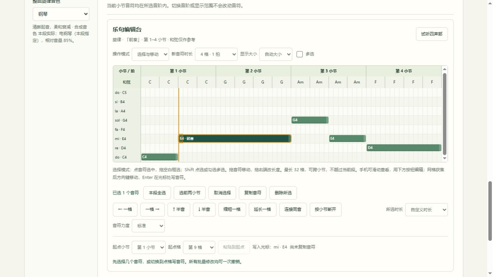
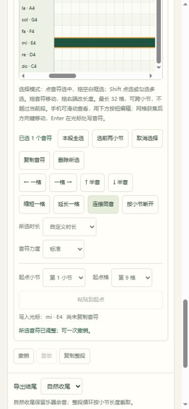

# 音芽 · v0.14.0 · 连贯乐句

面向零基础用户的音乐积木。基于 BeepBox 的合成器，通过旋律、和弦、贝斯和鼓点四层音乐，创作一段自己的短曲。

## 开始创作

先按 [README](README.md) 安装并启动项目，再打开 `http://127.0.0.1:9093/yinya/`。Windows 安装依赖后可双击根目录的 `启动音芽.cmd`。命令行服务器也可通过 `YINYA_PORT` 指定其他端口。

1. 选择「风中明信片」「暮色小径」体验完整大调、自然小调与扩展音域，或选择「晴窗律动」「夜航微光」「像素漫游」体验流行、舒缓与电子风格，或用「林间来信」学习前奏、主题、变化和结尾；也可选择三个四小节起点或从空白开始。
2. 在「作品长度」中选择 4–32 小节（四的倍数）；扩展时可追加空白或重复已有内容。每四小节一段，用段落卡片切换，再编辑其中一小节。
3. 旋律或贝斯先选 1、2、4、8、16、32 格时长，再点空格添加。点已有色块选中整音，可调整时长、按「删除音符」或在色块上按 Delete / Backspace 删除；小圆点标记起点。暂停时试听所选旋律或贝斯的实际时长，新和弦音色与分解演奏试听实际一拍和余音；原有圆润齐奏与鼓点保持约 0.32 秒试听。按「播放循环」听完整作品。
4. 播放时网格自动跟随当前小节；手动选择任意一节即可暂停跟随并继续修改。旋律和贝斯可选择五声音阶、完整大调或自然小调；音域覆盖两个八度。
5. 调整速度、整曲音量和音色；在段落面板展开「本段音色与音量」，单独安排每段配器，或从「晨光接力」「星灯渐远」体验完整变化。修改可以撤销和重做。
6. 段落可命名（1–24 字）、复制为新段、新增空白、前移、后移和删除；四声部、长音及本段声部开关一起移动，副本可独立修改。删除和缩短先提示，之后可撤销恢复。
7. 用本段四个声部开关安排乐器加入；关闭后音符仍保留并可编辑，整曲开关和音量继续生效。「循环这一段」固定循环所选四小节，手动查看其他段不改变范围；「从本段播放」从该段开头播放至整曲结束一次。
8. 「复制整段」覆盖已有目标段的四声部音符、长音、力度、本段开关及伴奏设置，保留目标段名称；覆盖已有音符前提示并可撤销。
9. 在段落编排中打开「旋律工坊」生成或改编一句旋律，或用「伴奏工坊」为当前四小节配贝斯及成套伴奏，先比较原版和候选，满意后再应用。
10. 保存到「我的作品」，通过分享链接发送作品快照，或导出 MP3、WAV 和 JSON 备份。

旋律音色有六种：柔软三角波、圆润波形、复古方波、钢琴、电钢琴和木吉他。后三种为合成音色，分别由 BeepBox 的钢琴、FM 电钢琴、钢弦吉他预设调校而来，不加载外部录音包。新音色已按相同音高与时长组合做 RMS 能量校准；这不等于所有音符在不同设备上的主观响度完全一致。

和弦音色可独立选择圆润波形、钢琴、电钢琴、木吉他。和弦层的「整曲演奏方式」提供齐奏、分解、轻扫弦、跳跃短奏和舒展分解；段落面板的「本段和弦伴奏」可跟随整曲或单独选择。改变整曲方式仅影响跟随整曲的段，音符和音色保留，空拍仍休止。

原三音和弦齐奏每拍同时响三音；原分解每拍按低 → 中 → 高 → 中弹四个短音。轻扫弦每拍按低音 → 两音 → 三音逐层加入，形成合成扫弦效果；跳跃短奏每拍两次短奏，之间留空；舒展分解先弹半拍低音，再弹两个四分之一拍的中、高音。四种和弦音色均可使用五种方式。新增 G7 为四音和弦：分解与舒展分解依次弹出四个音，轻扫弦逐层加入四音；齐奏和短奏保留四音，并做保守的能量校准。原有四组和弦的排列与节奏保持不变。

贝斯独立选择复古方波、柔和合成贝斯、拨弦风格贝斯。新贝斯使用合成声音，经过伴奏强度校准；不代表真实录音乐器。切换音色保留音高、时长、力度及整曲音量，新贝斯的自然收尾会保留需要越过曲尾的余音。

旋律和贝斯的「音符力度」提供轻、标准、重。选中音符后改变当前整音，包括所有延音格；未选中时设置后续新音符，两层分别记住设置。色块深浅与无障碍名称同时标记力度；时长调整、复制、段落重排、保存、分享和音频导出均保留力度，删除会清除该音符的力度。

在鼓点层选择六种原创「鼓点模板」及「应用范围」：当前小节或当前四小节段。「最后一小节加过门」会给范围内最后一小节加入短过门。填入后都是普通可编辑格子，覆盖已有鼓点前提示，支持撤销重做；其他声部及段落开关保留，鼓点已关闭时需要先开启相应整曲／本段开关才能听见。模板名描述节奏风格，「半速律动」不会改变整曲 BPM。


在旋律或和弦层选择「试听声部」：仅旋律，或旋律＋和弦。点击试听按钮只听当前四小节组，按钮旁显示范围；再次点击停止。双声部模式尊重各层开关和音量，可以在旋律静音时单听和弦，贝斯与鼓点不加入段落试听。切换音色后可用同一旋律比较，不会改变音符、音量或其他声部。所选试听声部均关闭、音量为零或当前段落没有对应音符时，按钮不可用；「点击试听」开关只控制点格子的单音，不影响主动试听段落。开始试听会暂停完整循环；切换声部/小节、编辑、撤销/重做、开始播放/导出或切到后台会停止试听。

「点击试听」开关在网格右上方，默认开启，设置只存在当前浏览器，刷新后仍生效。关闭后可安静编辑；删除音符、关闭声部或音量为零时不试听。循环播放中编辑直接改变音乐，避免额外声音叠加。快速点击切换到最新音，切换声部/小节、撤销重做、开始播放/导出和离开页面会取消未完成的试听。

旋律与贝斯都是 4 格一拍、8 格两拍。两层分别记住新音符长度，切换声部不会互相改动。长音最长 32 格，可跨小节且保持连续发音，不能超出当前四小节段；添加或延长遇到后面的音符、段落末尾，会自动收短并显示实际格数，保留后音。在长音中间点另一个音高，会在点击位置结束前音并开始新音；删除后音不会自动延长前音。相邻同音高的两个起点仍分别发音，旧作品的旋律和贝斯都不会被自动合成长音。选择时长同时设定后续新音符的长度；按「取消选择」后可用该长度继续添加。

「跟随播放」默认开启。小节按钮用绿色标记当前编辑小节，金色标记正在播放小节；网格同时高亮当前步和拍，显示播放进度。播放中手动选节会临时暂停跟随，音频继续循环；点击「回到播放位置」恢复跟随，不改变音频位置。暂停后重新播放会恢复临时停掉的跟随。主动关闭开关则会保存该偏好，刷新或再次播放仍保持关闭，点击试听偏好也继续保留。

「导出 MP3」完成后点击「下载 MP3」，获得 44.1 kHz、192 kbps 立体声文件；适合日常分享与播放。需要未压缩音频时，按「导出 WAV」后点击「下载 WAV」，获得 44.1 kHz、16 位立体声 PCM。

两种格式始终导出完整 4–32 小节作品，不受段落循环、当前编辑位置或试听范围影响。120 BPM 下为 8–64 秒，MP3 因编码延迟和补齐会略长。「导出结尾」默认自然收尾：旋律或和弦的新乐器余音越过曲尾时，取旋律、和弦及新贝斯所需的较长释放时间，最多约 0.58 秒；已有休止足够时不再追加。选「整段循环」严格按小节长度截取，新音色在末尾做短淡出。原有三个波形的导出长度及声音保持兼容。

段落试听、单音试听和导出均使用同一套音色定义与发音参数。合成和编码均在浏览器本地完成，编码器随项目保存，不使用外部音频服务。导出时显示进度，也可按「取消导出」；取消或失败不会丢失作品。

作品存在当前设备、当前浏览器和当前网站地址下。改用其他域名或端口时，先导出 JSON 备份，再到新地址导入。草稿会自动保存，命名作品需按「保存作品」。清理浏览器数据会移除本地作品，建议保留 JSON 备份。导入上限为 64 KB，容纳三十二小节作品的完整长音与力度数据。通过「另存改编」或分享链接载入的作品，保存时创建新版本。

当前链接为本机预览地址；公开部署之后朋友才能从其他设备直接打开。音芽分享链接和 JSON 使用自己的 v10 作品格式，兼容读取旧 v1–v9 作品，当前不直接导入 BeepBox 的历史链接或 JSON。

## 自由旋律与和声

「创作音阶」提供五声音阶、完整大调与自然小调。切换仅改变可选网格，已有音符不会改调或删除；当前小节已有的音阶外音继续显示，并用「音阶外」标记。五声音阶适合快速起步；完整大调补上 fa、si，自然小调提供降 mi、降 la、降 si。

旋律与贝斯支持完整两八度（含两端主音），可切换低八度、高八度或全部；音符标记可选唱名与实际音名。升降调后，实际音名同步更新；唱名以当前主音为基准。切换视图不改变作品，不在当前显示范围的音符会计数提示。较高的网格可在内部上下滚动，窄屏可左右滚动。

「整曲升降调」可在原调上下 12 个半音内调整，旋律、和弦、贝斯同步，鼓点不变。重复操作设定的是相对原调的总偏移；不会不断累积超出范围。旋律或贝斯还可按当前小节／当前四小节段升降八度；范围内任一音符超出两个八度，整次操作会拒绝，原内容保留。力度、长短音和声部安排均保留，支持撤销。

和弦层可看当前音阶常用和弦或全部 19 组，已用的借用和弦始终保留。原调和弦为 C、Am、Gsus2、Em7、F、G、Dm、G7、D、A、Bdim、Cm、Fm、Gm、D♯、G♯、A♯、Em、Ddim；旧 Em7 保留原有三音省略排列。名称随整曲移调同步变化。

六种走向按当前音阶提供：大调／五声音阶下有「明亮前行」「抒情回转」「温暖归来」，自然小调下有「夜色漫步」「静谧回声」「微光起伏」。只填入当前四小节段的和弦，每小节第一和第三拍发音，其他声部、音色、演奏方式和段落开关保留。覆盖已有和弦前确认，填入后仍可逐拍编辑或撤销。不会自动重写贝斯；需要时可自行搭配低音。

## 连贯乐句

旋律与贝斯的单音最长两小节（32 格），可从任意格开始跨过小节线，直到本段末尾。四小节视图中延音显示为一整条色块；点击试听、四声部试听、循环及 WAV／MP3 导出保持同一次起音。钢琴、吉他和拨弦贝斯保留自然衰减；新建的原始波形长音采用持续强度。旧作品的短音、长音及重复起音保持原有声音。

选中音符后用「所选时长」直接设为一或两小节，或拖尾调整任意 1–32 格。多选首尾相接、音高与力度相同的音符，按「连接同音」成为一个长音，合计不得超过 32 格；不同力度先手动统一。「按小节断开」在小节线处分成独立起音，保留音高和力度。单小节内部的两个相邻同音，连接后可用撤销恢复，断开按钮只在小节线切分。

单小节视图点击从前一小节延入的色块，会回到原起点并选中整音；删除、清空、八度移动作用于相交的完整音符。「复制到下一节」只取本小节实际发声部分，按小节线截取为独立音符；目标有跨小节长音时提示先断开，保护相邻小节；复制整段与复制乐句则保留完整长音。所有修改可撤销。

「长风入晨」展示舒展旋律，「潮汐低语」展示持续贝斯，均为十六小节原创起点。若前句长音延入后两小节，旋律工坊的「续写后半句」会提示先断开延音，避免改变前句；生成四小节和保留节奏改音高仍可使用。

## 乐句编辑台

编辑旋律或贝斯时，在「编辑视图」中选择「四小节乐句」。默认保留原有「单小节积木」入口，视图偏好只存在当前浏览器，不改变作品。和弦与鼓点继续使用原网格。上方显示本段四小节及逐拍和弦参考，空拍沿用本小节前一个和弦，首个和弦前显示空白；试听和整曲播放时，蓝色线标记正在播放的位置。

在「选择与移动」模式点音符选中，Shift 点选或勾选「多选」可逐个加入、取消。鼠标拖空白区域可框选，框选碰到长音主体即选中；「本段全选」「选前两小节」便于一次操作。桌面拖动选中的音符可整体移动，拖右端调整长度，松开后才应用；Esc、窗口失去焦点或作品变化会取消未完成的拖动。

选择「点格写音符」后点空白格添加，新音符时长可选 1／2／4／8／16／32 格。拖尾或「缩短／延长一格」可以调整为 1–32 格中的任意整数。手机支持直接滑动查看网格，点选音符后使用左／右移、升／降半音、长度、力度及删除按钮。显示大小可选自动、放大或更大；音域与音名沿用上方设置，所选范围外音符会计数提示，不会被删除。

移动可跨到本段的另一小节，保留音符间距、时长和力度。音符可以跨小节延音，同一个长音作为整体选择、移动、调整、复制及删除。移动、调整长度、添加或粘贴遇到重叠、越界时，整次修改拒绝，已有内容保留；不会自动收短、覆盖或删除后音。整体升降按半音进行，可能产生音阶外音，这些音会保留并显示。

「复制音符」保存本次所选音符，以最早起点为开头，保留中间空隙、时长和力度。在「起点小节／起点格」选择位置后按「粘贴到起点」，也可粘贴到另一段或贝斯。剪贴内容仅在本页面内存在，不使用系统剪贴板，刷新后清空；音色和配器不会随音符粘贴，目标段配器保留。移动、批量修改、粘贴和删除都能一次撤销、重做。

网格获焦时，方向键移动所选音符；未选音符时移动写入光标，Enter 在该音高和起点添加音符。Delete／Backspace 删除所选，Ctrl／Command+A 全选、C 复制、V 粘贴，Esc 取消框选或当前选择。快捷键只在乐句网格内生效。开始编辑会停止播放／试听；「试听四声部」使用当前本段配器，声音实际开始后同步移动播放线。

结果使用 v12 普通音符，保存、分享、JSON 备份与 WAV／MP3 都保留延音；v0.13.0 及更早版本无法读取新格式。选择、多选、光标、剪贴内容及拖动预览不会写入作品；其他声部、段落及配器保留。旧作品不会自动改写，未新增音源或云端服务。

## 段落配器

选中四小节段，展开「本段音色与音量」。旋律、和弦与贝斯分别提供现有音色，以及默认的「跟随整曲」。选择独立音色后，后续修改整曲音色不会影响这一段；重新选择「跟随整曲」即可同步。鼓点继续沿用现有鼓组。

四个声部各有本段相对音量，界面每次调整 5%。100% 保持整曲音量，50% 在其基础上减弱，0% 让本段该声部静音；音符仍保留可编辑。整曲静音、整曲音量与本段声部开关继续生效，段落设置不能解除整曲静音。段落卡片显示实际发声的配器与相对音量，侧栏也显示当前段实际音色。

「试听本段配器」比较当前四小节的完整四声部，可再次点击停止；编辑、切段、切到后台或开始其他播放会停止试听。点击音符、旋律／和弦试听、两个工坊、整曲播放与 WAV／MP3 导出都使用本段音色和音量。换段时先前乐器的正常余音可继续释放，导出自然收尾按实际最后发声的乐器处理。

「重置本段配器」让三种音色重新跟随整曲，四个相对音量回到 100%；保留音符、声部开关和本段和弦演奏方式。音色／音量修改和重置都可撤销、重做。复制整段、复制为新段、移动、重复扩展时配器一起保留；新增空白段默认跟随整曲、相对音量 100%。仅复制一个小节的音符不会改目标段配器。

新增两套十六小节原创示例：「晨光接力」用电钢琴前奏、钢琴主题、木吉他变化和钢琴结尾；「星灯渐远」用自然小调与较轻的伴奏，结尾回到电钢琴。可以查看卡片、逐段试听，再修改音符或配器。当前仍共用整曲速度与调性，未增加渐强渐弱曲线或新采样包。

## 旋律工坊

先选中一个四小节段，再打开「旋律工坊」。选择舒缓、轻快或跳跃风格，疏／中／密三档音符密度，以及低八度、高八度或完整两八度的生成范围。

- 「生成四小节」重写本段旋律，按当前音阶与和弦谱写，包含短句节奏重复和句尾收束。
- 「续写后半句」完整保留前两小节的音高、节奏、时长与力度，根据原句起伏写后两小节。前两小节没有旋律时会提示先写一句。
- 「保留节奏改音高」保留本段全部音符起点、休止、时长和力度，只改音高；本模式的密度设置停用。没有音符时会提示先生成旋律。

重拍优先使用当前和弦与音阶共有的音，弱拍可使用其他音阶内音。小节内和弦起点后的空拍沿用最近和声，首个和弦前与无和弦小节按音阶谱写，不借用上小节和弦。如果借用和弦与所选音阶没有共同音，会保留音阶并提示。续写中原句超出生成音域或包含音阶外音时仍原样保留。新生成的长音会在和声变化、后音或小节末尾收短；改音高模式则完整保留原时长。

同一候选反复试听保持固定，点击「换一版」才切换候选编号；更改设置会按当前编号重新生成。「试听原版／候选」听本段完整四声部，遵循本段与整曲开关和音量，不写入草稿。切换设置、停止、关闭或切到后台会取消试听。候选摘要列出音符数量与实际音名，供应用前比较。

「在本段开启旋律」默认勾选，只改变本段旋律开关，整曲静音和音量仍生效。覆盖已有旋律前确认，取消返回工坊；应用后选中第一个改动小节并显示所选音域，可以一次撤销或重做。和弦、贝斯、鼓点、其他段落及整曲设置保留。生成内容都是普通音符，可逐格修改、复制、重排、保存、分享与导出，之后修改和弦不会自动重写旋律。

旋律规则在本地运行，不调用外部生成服务。规则提供创作候选，音乐是否合适仍需试听判断；本轮只处理当前四小节，长音仍限于单个小节。

## 伴奏工坊

先选中要改编的四小节段，再打开段落编排中的「伴奏工坊」。工坊生成临时候选，试听和关闭都不改动草稿。应用后，候选变成普通音符，可以逐格编辑、复制、重排、撤销、保存、分享和导出。改动和弦不会自动重写已生成的贝斯，需要时可再次生成。

「只配贝斯」沿用本段和弦，有三种模式：平稳长音用根音托住和声，最多两拍一音；根音交替每拍交替根音和和弦内音；八度律动每半拍在根音与高八度之间交替，并搭配轻、标准力度。换和弦时从新根音开始，前一个贝斯音不会越过和弦变化。减和弦、挂留和弦及旧 Em7 使用自身的和弦内音，不强行套入纯五度。

生成贝斯时，同一小节内，和弦起点之后的空拍沿用最近的和声；第一个和弦之前和全空和弦小节保持休止。不会从上一小节或相邻段借和弦。若本段完全没有和弦，会先提示填入和弦；仍可单独生成鼓点。

「成套伴奏」提供三组搭配：轻快流行使用根音交替、轻扫弦和流行鼓点；温柔抒情使用平稳长音、舒展分解和舒缓鼓点；电子律动使用八度律动、跳跃短奏和电子四拍。贝斯模式可以再单独调整，鼓点在本段最后一小节加入过门。

可以分别勾选和弦、贝斯、鼓点。和弦默认沿用已有音符，仅改变本段演奏方式；选「采用风格走向」才替换和弦，走向按当前大调／五声音阶或自然小调提供，并按整曲升降调显示实际名称。未勾选和弦时，贝斯始终依据原来的和弦生成。未勾选的声部与旋律保留。

「在本段开启所选声部」默认勾选，只改变当前段的对应开关；取消后保留本段开关。整曲开关、音量、音色、速度、调性和其他段落始终保留。若整曲声部关闭或音量为零，候选仍会静音并提示检查设置。

「试听原版」「试听候选」比较当前四小节的完整四声部，遵循各层开关和音量；可以随时停止。切换设置、再次试听、关闭工坊或切到后台都会取消已有或尚未完成的试听。覆盖已有伴奏前需要确认，取消可返回工坊继续比较；确认后一次撤销可以恢复整个修改。

生成规则与音频合成均在本地完成，不调用外部生成服务。本版使用 v12 作品格式和 `yinya.v12.*` 存储键，旧作品不会自动生成或重写伴奏，已有段落配器在生成时保留。

## 开发与检查

需要 Node.js 24 和 npm。音芽构建无需 Bash；上游原有脚本继续保留。

```powershell
npm ci --ignore-scripts
npm run build-yinya
npm run test-yinya
npm run start-yinya
```

如果 npm 默认缓存目录不可写，可以在项目中指定临时缓存目录：

```powershell
npm ci --ignore-scripts --cache .npm-cache
```

构建入口 `scripts/build-yinya.mjs` 将界面、BeepBox 合成器及上游 WAV 渲染器打包到 `website/yinya/assets/app.js`。同时生成独立的 MP3 Worker（`assets/mp3-worker.js`），运行时引用原样保存的 `vendor/lamejs.js`。运行服务器仅绑定 `127.0.0.1`。可设置 `YINYA_PORT` 环境变量修改命令行服务器端口；双击启动器使用 9093。

- `yinya/phrase.js`：四小节内的严格、原子音符编辑、矩形选择和页面内复制数据。
- `yinya/phrase-editor.js`：连续乐句视图、指针预览与取消、多选、触屏按钮和键盘编辑。
- `yinya/melody.js`：三种风格、三档密度、生成／续写／改音高模式与固定候选规则，只输出普通旋律音符。
- `yinya/accompaniment.js`：三种贝斯规则、三套伴奏组合、四小节范围与声部选择；生成普通音符，不保存隐藏生成状态。
- `yinya/theory.js`：固定音高 ID、三种音阶、19 组和弦、6 种走向及显示名称。前八个音高 ID 保留旧五声音阶映射，新半音追加 ID；不可按网格行号解释历史音高。
- `yinya/model.js`：作品结构、原创起步作品、校验、分享编码和音频数据转换。
- `yinya/voices.js`：固定版本的六种旋律和四种和弦音色、纯数据预设及独立能量校准参数。
- `yinya/render.js`：带静音尾段的音频渲染、自然收尾和四小节旋律或旋律＋和弦快照。
- `yinya/app.js`：中文编辑界面、本地存档、分享、导入导出与音频调度。
- `yinya/mp3.js`、`mp3-worker.js`：PCM 到 MP3 的适配及后台编码。
- `website/yinya/`：页面、样式、标识、独立编码器与许可证。
- `yinya/grooves.js`：六种原创鼓点模板与可编辑过门。
- `yinya/song.js`：统一声音构造及有界音符力度，保留标准力度下的旧引擎参数。
- `yinya/preview.js`：使用实际 BeepBox 音色合成短音、管理 Web Audio 播放与取消。
- `yinya/playback.js`：播放范围配置（整曲、段落循环、从本段到结尾）及自动跟随视图状态。
- `tests/`：作品数据、分段音色和音量、实际 BeepBox 音频引擎、旋律／伴奏生成、齐奏与分解演奏、试听、跟随与独立 MP3 解码、长曲、旋律与贝斯长音、备份大小边界、音色能量、曲尾及旧作品兼容测试（225 项）。
- `scripts/package-yinya.mjs`：生成仅含音芽运行文件与许可证的静态网站包。
- `.github/workflows/yinya-ci.yml`：Linux / Windows 的安装、测试、构建和网站包检查。
- [部署说明](docs/DEPLOYMENT.md)：静态网站包及部署验收。
- [版本变化](CHANGELOG.md)：已完成的功能。

桌面与手机预览：





## 上游与授权

上游：[johnnesky/beepbox](https://github.com/johnnesky/beepbox)。版权归 John Nesky 及贡献者，MIT 许可证保留于 `LICENSE.md`，页面也提供署名和许可证入口。

音芽首版的界面、品牌标识和三段起步作品为本次新增。声音通过合成生成，不使用外部歌曲或音频采样。MP3 使用独立的 LGPL-3.0 编码器，仅在导出时加载，保留原样模块及完整许可证。详情见 [第三方组件说明](THIRD_PARTY_NOTICES.md)；页面底部也提供「开源组件说明」入口。

作品使用 v12 格式，旋律和贝斯在起点保存 1–32 格完整时长，跨小节部分不新增独立音符，不能越过四小节段落。兼容读取旧 v1–v11；旧作品只迁移格式标记，保留原有配器、音符及声音。新草稿和作品库使用 `yinya.v12.*`，仅在新键不存在时按 v11 至 v1 顺序读取并保留旧键；已有 v12 存档优先，读取失败不会静默覆盖为旧稿。拒绝重叠、越界、未知音色或无效力度。v0.13.0 及更早版本无法读取 v12，回退前请保留旧版 JSON 备份。

225 项测试包括冻结 v0.7.0–v0.13.0 的转换基准、旧格式迁移、25 种移调、音域边界原子拒绝、19 组和弦经过真实解析器保留全部音、旋律生成规则、固定候选、分段配器的乐器选择／音量／静音／余音，以及乐句编辑的原子冲突、复制粘贴、框选、指针预览／取消／过期保护和触屏分支。还覆盖试听与导出 PCM 对照、三档力度、32 小节 WAV／MP3 与独立解码。实体手机及更多浏览器的长曲内存和耗时需继续验证。长音限制在同一四小节段内，各段共用整曲调性与速度。
