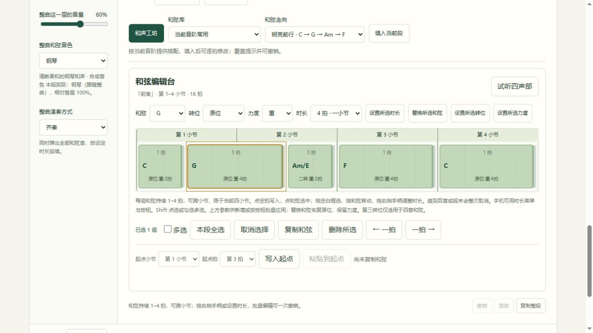

# 音芽 · Yinya

[](https://github.com/Liu-Ice-cream/yinya/actions/workflows/yinya-ci.yml)

让旋律发芽。音芽是面向零基础用户的音乐积木：点亮格子，组合旋律、和弦、贝斯与鼓点，留下自己的一段音乐。

当前版本 **v0.18.0 · 和声延展 · 早期体验版**，基于 [BeepBox](https://github.com/johnnesky/beepbox) 合成器开发独立中文创作界面。



## 可以做什么

- 「和声延展」支持每组和弦持续 1–4 拍，在当前四小节内跨小节延续。拖右侧手柄或通过时长菜单调整，复制与批量编辑保留时长；重叠、越界整次拒绝，可一次撤销。齐奏与扫弦持续，分解与短奏保持每拍节奏；新增慢速示例「雾中晨光」「海岸晚风」。

- 「和声工坊」保留四小节的和弦种类和空拍，提供平滑连接、恢复原位及重拍／轻拍候选，四声部比较试听后应用，可一次撤销。平滑连接保留第一组和弦的转位，按声部音高移动距离选择后续转位。
- 「和弦编辑台」连续显示 16 拍，支持框选、多选、复制粘贴、移动、批量替换及删除，每拍独立设置原位／转位与轻／标准／重力度；第三转位适用于四音和弦。新增「和光流转」「晚风和声」示例，保存及 WAV／MP3 保留结果。

- 「节奏工坊」提供六种节奏模板、末小节过门和轻重交替，原版／候选四声部试听后应用，可一次撤销。三套本地合成鼓组：原始、柔和、电子，整曲与本段可分别选择。
- 「鼓点编辑台」连续编辑四小节低鼓、小鼓与沙帽，支持框选、多选、复制粘贴、跨小节／跨行移动、批量删除及逐击轻／标准／重力度。同拍三行力度独立，冲突或越界整次取消；新增「暖拍漫步」「电光节拍」示例。

- 「动态编曲」为每段四个声部设置 0–100% 起止音量，整段平滑过渡；四种模板、变化曲线、原版／候选试听和一次应用撤销。渐变保留在保存、分享、段落复制及 WAV／MP3 中，新增「微光渐起」「晚风收声」示例。

- 「连贯乐句」：旋律／贝斯最长 32 格，可跨小节延音，在当前四小节段内连续发音；同音连接、按小节断开、整音拖动与撤销，新增「长风入晨」「潮汐低语」示例。

- 「乐句编辑台」连续查看四小节旋律或贝斯及和弦参考，拖动移动／改长度、框选或多选、复制粘贴、批量力度与删除；重叠或越界整次拒绝，一次修改一次撤销。手机可滑动查看并用按钮编辑，原单小节视图保留。
- 每段独立设置旋律、和弦、贝斯音色，或跟随整曲；四声部各自调整本段相对音量，段落卡片显示实际配器。支持四声部试听、重置及撤销，新增完整示例「晨光接力」「星灯渐远」。
- 在「旋律工坊」按当前音阶与和弦生成四小节，续写后半句，或保留节奏改音高。提供舒缓／轻快／跳跃、三档密度与音域；候选固定，可换一版、比较原版与候选，再确认应用，支持整次撤销。
- 在「伴奏工坊」为当前四小节配贝斯，或搭配轻快流行／温柔抒情／电子律动伴奏。可选择要改动的声部，比较原版与候选后再应用，支持覆盖取消和撤销。

- 保留五声音阶，新增完整大调、自然小调及两个八度的旋律／贝斯编辑范围，切换音阶保留并标记音阶外音。
- 整曲可升降 12 个半音，同步旋律、和弦与贝斯；支持当前小节或四小节段的旋律／贝斯升降八度，超出音域时整次保留原内容。
- 19 组和弦、6 种四小节走向模板，覆盖提示并可撤销；新增「风中明信片」「暮色小径」两首完整示例。
- 从「晴窗律动」「夜航微光」「像素漫游」三首风格示例、「林间来信」、三个四小节起点或空白开始。
- 支持 4–32 小节，每次增减四小节；段落可命名、复制、新增空白、前后移动及删除撤销，四声部与长音一起移动。
- 每段独立安排旋律、和弦、贝斯和鼓点进入；关闭声部仍保留音符。可循环当前段，或从本段播放到整曲结尾一次。
- 编辑四层音乐积木，调整速度、音量、旋律／和弦／贝斯音色与声部开关，撤销和重做。
- 旋律和贝斯均可选择 1、2、4、8、16、32 格时长，连续色块标记长音，点按选中后调整或删除；增加轻／标准／重三档力度，用色块深浅区分。
- 和弦独立选择圆润波形、钢琴、电钢琴或木吉他，支持齐奏、分解、轻扫弦、跳跃短奏和舒展分解；每段可单独设置伴奏或跟随整曲；四小节试听可选「仅旋律」或「旋律＋和弦」。
- 六种原创鼓点模板可填入当前小节或当前四小节段，并可在最后一小节加入过门；填入后仍可编辑，覆盖提示并可撤销。
- 贝斯独立选择复古方波、柔和合成贝斯或拨弦风格贝斯。
- 六种旋律音色：钢琴、电钢琴、木吉他及原有三种波形；可单独试听当前四小节旋律，比较声音。
- 点击音符即时试听，循环播放完整作品，自动跟随当前播放小节；手动查看后可一键恢复跟随。
- 在当前浏览器保存作品，通过链接分享快照并继续改编，导入/导出 JSON 备份。
- 在浏览器本地导出 WAV 或 MP3，MP3 为 44.1 kHz、192 kbps 立体声。
- 导出可选自然收尾保留乐器余音，或整段循环保持小节长度。

## 本地体验

需要 **Node.js 24** 和 npm。在项目目录执行：

```sh
npm ci --ignore-scripts
npm run build-yinya
npm run start-yinya
```

打开 <http://127.0.0.1:9093/yinya/>。Windows 完成安装后，也可双击 `启动音芽.cmd`。当前尚未提供公开在线演示，静态网站部署方法见 [部署说明](docs/DEPLOYMENT.md)。

## 当前范围

音乐长度支持 **4–32 小节（四的倍数）**，默认四小节；旋律和贝斯可选五声音阶、完整大调或自然小调，覆盖两个八度。120 BPM 下为 8–64 秒。每段固定四小节，可选择单小节积木或四小节编辑台；通过段落声部开关安排前奏、主题、变化和结尾。WAV / MP3 始终导出全部段落，不受当前试听或循环范围影响。更多方向见 [后续方向](docs/ROADMAP.md)。

钢琴、电钢琴、木吉他、新贝斯及三套鼓组采用本地合成预设，未引入录音采样包。自然收尾仅在新乐器的余音需要越过曲尾时追加最多约 0.58 秒；整段循环和原有波形保持作品小节长度。

作品仅保存在当前设备、当前浏览器、当前网站地址下，无账号和云端同步。清理网站数据可能丢失作品，建议下载 JSON 备份。本机分享地址只能在本机使用；部署到可访问的网站后才能跨设备打开链接。当前使用音芽 v16 格式和 `yinya.v16.*` 存储键，兼容读取旧 v1–v15 草稿、作品、分享链接与 JSON 备份，保留旧键及原有声音。旧作品和弦默认一拍，已有转位、力度、鼓组、配器和音量不变。v0.17.0 及更早版本不能读取新 v16，回退前请保留旧版备份。JSON 备份上限为 96 KB，容纳 32 小节表达数据；分享长度上限仍为 20,000 字符。不直接导入 BeepBox 历史链接或 JSON。

## 开发与反馈

```sh
npm run test-yinya
npm run package-yinya
```

327 项自动测试覆盖作品数据、分段配器与余音、实际合成器、旋律与伴奏生成、点击试听、播放跟随和独立 MP3 解码。GitHub Actions 在 Linux 与 Windows 上构建和测试，主分支检查通过后提供 `yinya-site` 静态网站包。

- [详细使用说明](README-YINYA.md)
- [版本变化](CHANGELOG.md)
- [贡献与问题反馈](CONTRIBUTING.md)
- [部署说明](docs/DEPLOYMENT.md)

## 来源与许可证

音芽保留 BeepBox 的完整 Git 历史及原作者署名。BeepBox 和音芽代码采用 [MIT 许可证](LICENSE.md)。MP3 编码器 **@breezystack/lamejs 1.2.7** 作为独立、原样的 LGPL-3.0 模块分发，其许可和源码入口见 [第三方组件说明](THIRD_PARTY_NOTICES.md)。原创起步作品使用合成声音，不包含外部歌曲或录音采样。

上游教程保留于 [README-BEEPBOX.md](README-BEEPBOX.md)。
